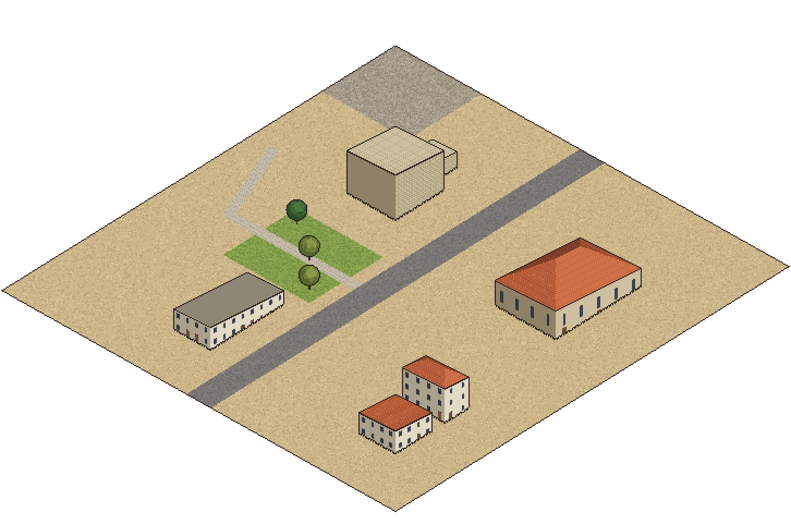
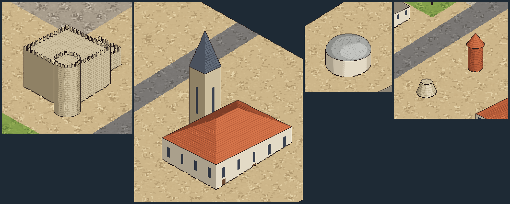

# rendering — scene → master image (WP04)

Offline, deterministic isometric pixel-art renderer. Reads a scene directory
(`docs/contracts/scene.md`) and a city config, writes the render directory of
`docs/contracts/render.md` §1: `render.json`, `palette.json`, `color.png`, `class.png`,
`buildingId.png` + `buildingId.json`, and `depth.png` with `--depth`. No GPU, browser, network,
paid service or generative AI.

```sh
bun ci
bun run render --scene ../../tests/fixtures/scene-synthetic \
  --city ../../tests/fixtures/city-synthetic/city.json --out ../../build/planeville/render [--depth] [--chunk 2048]
bun run lint     # bun lint (warnings are errors) + bun fmt --check + bun check (strict)
bun run test     # bun test: projection vectors, golden pixel hashes, chunking, registration, CLI errors
bun run build    # type-check only (the package runs from source under Bun)
```

`--chunk` is the internal render-tile size in pixels; it never changes the output (tested).
Invalid input (a `scene.json` or `city.json` that fails its schema, a layer whose sha256 differs
from the manifest, a non-finite number, a city/scene origin mismatch) exits with status 1 and a
message naming the file; bad arguments exit with status 2.



## Design

Two stages (`docs/decisions/0002-render-backend.md`, `0006-render-backend.md`):

1. **G-buffer** (`src/raster.ts`): a TypeScript software rasteriser. Per chunk, it fills a
   surface-id buffer (`Uint32`) and a depth buffer (`Float64`, `d` of projection.md §3) with a
   one-pixel margin. Terrain cells (two triangles on a fixed NW–SE diagonal), building and
   structure walls (back faces culled), roofs and tree spheres/trunks. Surface-local
   coordinates are recovered exactly in stage 2 from `(X, Y, d)` with the surface pick of
   projection.md §5.3, so the G-buffer stores only id and depth.
2. **Styling** (`src/style.ts`): a pure function of the G-buffers, the scene attributes, the
   top-down ground grid and the palette. It produces palette indices, class codes and building
   indices; nothing else draws.

`src/geometry.ts` turns the scene into primitives: walls are footprint edges extruded from
`baseH` to `baseH + heightM` (holes give courtyard walls); `flat` and `unknown` roofs are a flat
polygon at the wall top; `pitched` parts with a convex single-ring footprint get a hipped roof
(each facet is the region closest to one eave edge, so the ridge direction follows the shape;
pitch 30° capped at the 6 m allowance, or rising to exactly `ridgeHeightM` when present).
Non-convex or holed `pitched` parts fall back to flat geometry with a tile texture: no ridge is
invented. Roads (buffered by `widthM / 2`, tunnels skipped, bridges flat) and landcover are
rasterised into a 0.25 m ground-class grid over the AOI and looked up for every terrain pixel.
Everything outside the render prism (AOI × `[zMin, zMax]`) is clipped per pixel.

## Style

- **Palette**: `palette.json`, 64 colours (61 + 3 slate for landmark details) of my own choosing (≤ 64): limewash and ochre walls,
  pale stone for fortifications and landmarks, terracotta and grey-beige flat roofs, dusty
  ground, asphalt, stone paving, olive and pine greens, water. Every drawn pixel is one of
  them; undrawn pixels have alpha 0. `background` in `render.json` is `#1e2a35`, also in the
  palette so flattened tiles stay exact.
- **Light**: fixed in the world, from the sun at bearing 205° (south-south-west), elevation 45°.
  Lambert `n·L` is quantised into four bands (≥ 0.85, ≥ 0.60, ≥ 0.35, below); with the default
  camera the south façades are band 1, the west façades band 3, flat roofs and flat ground
  band 1, sunward hip facets band 0. No gradients.
- **Façades** from metric surface coordinates (metres along the wall, height above `baseH`):
  `floors`, else `round(heightM / 3)`, windows per floor in bays of about 3 m, doors on the
  ground floor in bays chosen by a hash of the part id and edge number. `use` picks the family:
  housing (limewash or ochre per hash of `buildingId`, with a darker plinth), shops (wide
  ground-floor windows), civic (stone, larger windows), religious (tall windows, sandstone or
  stone), industrial (concrete, ribbon windows, one large door), agricultural (ochre, sparse
  openings), fortification (pale stone courses, no openings). `landmark` parts get stone.
- **Roofs**: terracotta courses parallel to the eave (or the longest edge for flat-geometry tile
  roofs), flat roofs with a light parapet band and a 1 m tile grid, stone tops on
  fortifications. `unknown` roofs on non-industrial parts are textured as tile (allowed by the
  prompt; geometry stays flat).
- **Ground**: speckle and ordered (Bayer 4×4) dithering anchored to world cells and absolute
  image pixels; stone-paving joints; furrows on farmland; ripples on water.
- **Trees**: a sphere of `crownRadiusM` whose top is at `heightM`, shaded by its normal, on a
  trunk; olive or pine colouring by a hash of the tree id.
- **Outlines**: 1 px, colour `outline`, on the nearer side of any silhouette (against
  background) and of any boundary between objects (terrain, a part's walls, a part's roof,
  a tree crown, a trunk).
- No anti-aliasing, filtering or colour management anywhere. Nothing comes from Isometric NYC,
  Tiny València or any other project.

The `class` layer uses 1 ground (default ground, paved, bare rock, sports, cemetery),
2 road, 3 wall, 4 roof, 5 vegetation (trees, park, scrub, woodland, farmland), 6 water.
7 landmark-detail (pixels of the curated solids below). `class.png` is an 8-bit palette PNG (the
samples are the class codes; its PLTE is only for viewing). `buildingId.json` is
`[null, <part ids…>, <detail ids…>]`: building parts in file order, then structures, then details.

## Landmark details (scene contract v1.1, ADR 0008)



`scene.json` with `schemaVersion` 1.x is accepted. The optional `details` layer is checked like
the others (file present, sha256) plus its feature `count`, and every property strictly: unknown
keys, a bad `kind`/`material`/`sides`, a non-positive `heightM`/`radiusM`, a negative
`topRadiusM`, `topRadiusM`/`sides` on anything but a cone, `parapet` on anything but a cylinder,
`openings` other than `arcade` or on anything but a cylinder, `radiusM` on a gable, a missing or
non-positive `lengthM`/`widthM`/`wallHeightM` on a gable, `wallHeightM` ≥ `heightM`, a
`roofMaterial` other than tile/slate/metal, any of those four on another kind,
`shapeSource` other than `reference` or a duplicate id fail with `details.geojson: detail <id>: …`.
Part properties `parapet` and `material` are validated the same way. A scene without these renders
exactly as before (the original golden hashes and the Villena scene were checked unchanged).

- **Geometry** (`addDetail` in `src/geometry.ts`): each detail is tessellated into planar facets
  around its axis and rasterised like walls and roofs, depth-tested against everything else
  (drawn after the parts, before the trees). Facet count is fixed by the radius in pixels: about
  3 px per facet, `max(8, min(128, 4·ceil(r_px / 2)))`. Cylinder: side quads and a flat top cap.
  Cone: quads from the base ring to the `topRadiusM` ring (top cap when > 0) or triangles to the
  apex; `sides: 4` is a square pyramid/frustum whose face normal points at `rotationDeg`. Dome:
  half ellipsoid in `ceil(n / 4)` latitude rings ending at the pole. Gable: a `lengthM` × `widthM`
  box centred on the point with its ridge along bearing `rotationDeg`: two long walls up to
  `wallHeightM`, two pentagonal end walls (vertical gables) up to `heightM`, two roof slopes.
  Vertices use the package's own `sinDeg`/`cosDeg`. Back faces are culled.
- **Battlements**: on a part with `parapet: "battlement"`, every wall edge (holes too) carries
  merlon boxes 0.7 m wide, 0.9 m high, 0.5 m deep on its inner side, starting and ending at the
  edge's vertices with gaps as close to 0.7 m as a whole count allows (`merlonSpans`); edges under
  0.35 m get none. Merlon fronts are wall surfaces of the part (same masonry, no outline against
  the wall below), merlon tops roof surfaces. On a cylinder the rim carries
  `max(6, round(2πR / 1.4))` merlons of the same size.
- **Style**: materials map to palette ramps — stone `stone`, brick `terracotta`, plaster
  `limewash`, tile `terracotta`, slate `slate` (3 colours added, palette version 2, 64 colours),
  metal `concrete`. A part's `material`: `stone` gives the fortification masonry (staggered
  0.6 × 1.2 m courses) and no windows or doors — a church or castle wall is not a house front;
  `brick` gives terracotta with 0.5 × 1 m courses and `plaster` plain limewash, both keeping the
  window layout of the part's `use`. Round
  sides are shaded per pixel by the analytic normal of the solid (cylinder radial, cone with its
  slope, dome ellipsoid gradient) with the usual sun and four bands, plus a 4×4 ordered dither of
  ±0.03 on `n·L` so the band steps read as a curved surface; square pyramids, caps and merlons use
  flat facet bands. Textures in metres around the solid and above its base: stone courses
  0.6 m × 1.2 m staggered, brick 0.5 × 1 m, slate 0.6 × 1 m, metal vertical panel seams every
  1.2 m, plaster plain. Tile on a cone or frustum runs radially: channels down the slope about
  0.9 m apart at the eave and darker seams between panels about 8 m wide (a fraction of a turn
  around the axis, so the pattern is fixed to the solid); a tile cylinder keeps 0.45 m courses. A
  metal dome carries a faint panel grid: meridians about 3 m apart at the base, stopping short of
  the crown, and parallels at equal steps of the pseudo-latitude `q / (r/R + q)` (`q` = height
  fraction; no `atan`). `openings: "arcade"` on a cylinder cuts two tiers of round-headed dark
  openings (≈ 2 m wide, ≈ 3 m tall, about 4 m apart around the wall, anchored to the angle) with a
  shadowed cornice line between the tiers. Gable walls are masonry like the other details; the
  long walls get pilasters (0.8 m, a shadow line on one side) between bays of about 6 m and one
  narrow arched slit window per bay; the end walls are plain. The roof slopes use the building
  roof textures in `roofMaterial` with courses parallel to the ridge (tile 0.45 m rows, slate
  0.6 × 1 m, metal standing seams down the slope every 1.2 m). A detail's sides and its top (roof
  slopes on a gable) are two outline keys, so silhouettes and the rim get the usual 1 px outline.
- **Tests** (`test/details.test.ts`): a synthetic scene (`test/detail-scene.ts`: the fixture plus
  a battlemented keep, a battlemented stone cylinder, a church rotated 70° — stone gable nave,
  stone tower part, slate square spire —, a small bullring — arcaded plaster drum, tile roof
  ring, metal dome —, a brick turret with a tile cone and a stone frustum) with committed hashes
  in `test/golden-details.json` (`UPDATE_GOLDEN=1 bun test` rewrites them), chunk-size
  independence, class 7 ⇔ detail id in the index, the dome silhouette, the rotated spire and
  gable against extents computed in the test from projection.md with the platform trigonometry
  (the spire's front corner and the gable's extent for `-rotationDeg` are asserted to differ, so
  a sign flip fails; checked by mutating the renderer), no window/door pixels on the stone tower
  part, dark openings on the arcaded drum, merlons above the keep, and the validation failures.
  `bun test/contact-sheet.ts` regenerates the image above.

## Determinism

- Only IEEE-754 basic operations and `Math.sqrt/floor/ceil/round/min/max/abs/imul` are used.
  Sine and cosine of the camera and sun angles come from a fixed Taylor series
  (`sinDeg`/`cosDeg`), because ECMAScript leaves `Math.sin` implementation-approximated; a test
  fails if a transcendental `Math` function appears in the source.
- Vertices are snapped to 1/256 px; coverage uses the even-odd rule at pixel centres with
  half-open spans, so shared edges are drawn once. Depth and every texture are evaluated from
  absolute image coordinates, never incrementally, so chunk size cannot matter; the one-pixel
  G-buffer margin gives outlines their neighbours across chunk edges.
- Ties in depth go to the primitive drawn first; the order is fixed (terrain cells, then parts
  in scene order, then details, then trees). All variation comes from FNV-1a/xorshift hashes of ids and
  integer cell coordinates.
- PNG: own encoder (`src/png.ts`), one IDAT, filter Sub on every row, `node:zlib` level 9 as
  bundled with Bun, no ancillary chunks. `renderer.version` records the zlib and Bun versions.
- `test/golden.json` holds the `pixelSha256` of every layer for the synthetic scene (with
  `--depth`); `bun run test` compares it, renders with chunk sizes 64, 300, 1000 and 2048, and
  checks two runs give byte-identical files.

Cross-platform check (run from the repository root; the extra anonymous volume keeps the
container's `node_modules` away from the host's):

```sh
docker run --rm --platform linux/amd64 -v "$PWD":/w -v /w/pipeline/rendering/node_modules \
  -w /w/pipeline/rendering oven/bun:1.4 sh -c "bun ci && bun run render \
  --scene ../../tests/fixtures/scene-synthetic --city ../../tests/fixtures/city-synthetic/city.json \
  --out /tmp/r --depth && bun -e 'for (const l of (await Bun.file(\"/tmp/r/render.json\").json()).layers) \
  console.log(l.name, l.pixelSha256)' && bun test"
```

On 2026-11-15 this printed the golden hashes on `x86_64` (macOS arm64 host: identical), and the
Villena fallback scene gave identical `pixelSha256` on both platforms and for chunk sizes 2048
and 1500. After the v1.1 details the same command passed all 24 tests in the container,
including `test/golden-details.json`; after round 2 (gable, arcade, textures) it printed the
same golden hashes and passed all 26 tests.

## Performance (Apple M5, 24 GB, Bun 1.4.4)

| Scene                                                                     | Image          | Time   | Peak RSS |
| ------------------------------------------------------------------------- | -------------- | ------ | -------- |
| Synthetic fixture                                                         | 726 × 481      | 0.1 s  | 73 MB    |
| Villena fallback scene (7 721 parts, 1 m terrain, 505 roads)              | 11 314 × 6 836 | 10.2 s | 3.0 GB   |
| same, `--depth --chunk 1500`                                              | 11 314 × 6 836 | 14.9 s | 4.2 GB   |
| same, `linux/amd64` container under emulation                             | 11 314 × 6 836 | 19.7 s | 2.6 GB   |
| Villena full scene (8 108 parts, 4 789 trees) + 60 test details           | 11 314 × 6 981 | 11.8 s | 2.9 GB   |
| same, `--depth`                                                           | 11 314 × 6 981 | 17.2 s | 4.6 GB   |
| Villena v1.1 scene (11 600 parts, 10 637 trees, 21 details), no `--depth` | 15 557 × 9 006 | 20.6 s | 5.3 GB   |

The details add about 0.6 s on that scene (11.2 s without them). The budget is 10 minutes and
8 GB; at the v1.1 AOI the measured 5.3 GB without `--depth` leaves room, while `--depth` would
need ≈ 8 GB (extrapolated, not run), so render the full city without `--depth`. Memory is dominated by the full-image output buffers
(≈ 40 bytes per pixel with `--depth`); time grows roughly linearly with pixels and terrain cells.

## Dependencies (pinned in `bun.lock`)

| Package                                                       | Version             | Licence      | Use                                                                |
| ------------------------------------------------------------- | ------------------- | ------------ | ------------------------------------------------------------------ |
| ajv                                                           | 8.20.0              | MIT          | validate `scene.json` and `city.json` against the contract schemas |
| fast-deep-equal, json-schema-traverse, require-from-string    | 3.1.3, 1.0.0, 2.0.2 | MIT          | ajv dependencies                                                   |
| fast-uri                                                      | 3.1.9               | BSD-3-Clause | ajv dependency                                                     |
| @types/bun (dev; brings bun-types, @types/node, undici-types) | 1.4.4               | MIT          | types                                                              |

Bun 1.4.4 itself runs the package; its bundled zlib encodes the PNGs.

`docs/spike-a-threejs.mjs` is the throwaway Three.js spike behind ADR 0006; it is not part of
the package and needs `three` and `playwright` installed elsewhere.
